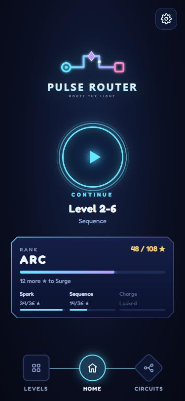
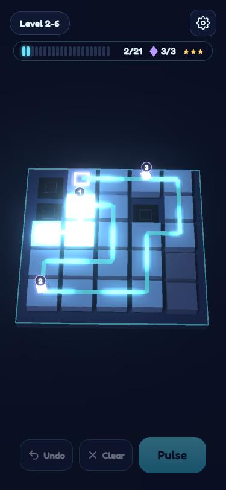
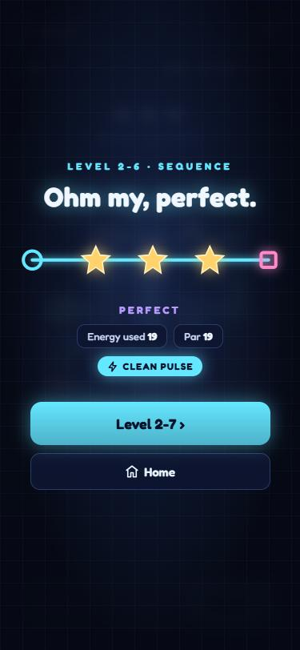
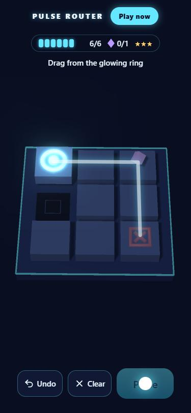
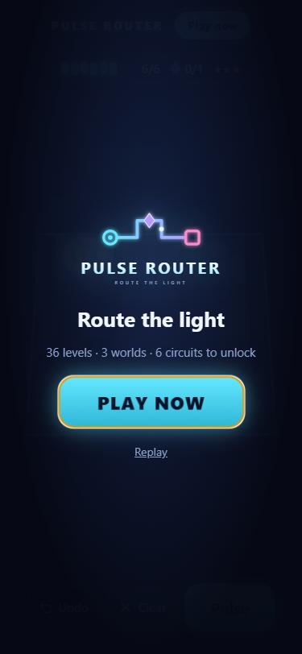

# Pulse Router

**[▶ Play the game](https://mk55a.itch.io/pulse-router)**

**Playable ad variants:**

**[▶ Tutorial](https://mk55a.github.io/pulse-router/playable/)** ·
**[▶ Fix it](https://mk55a.github.io/pulse-router/playable/?variant=fixit)** ·
**[▶ Chain reaction](https://mk55a.github.io/pulse-router/playable/?variant=chain)**

  
  
  

## Playable ads

Three variants from one template, each testing a different hook.

  
  

Each variant plays the same on every network; only the wrapper changes (how it starts, pauses and
opens the store).

| Network | Format | Limit | Delivered |
|---|---|---|---|
| AppLovin, Unity Ads, ironSource, Liftoff (MRAID), Mintegral | single HTML | 5 MB | 743 KB |
| Meta | single HTML | 2 MB | 743 KB |
| Google Ads, TikTok | ZIP | 5 MB | 190 KB |

Kept small the same way for every network:
- No audio files: every sound is synthesised in the page when the ad loads
- No image files or web fonts: glows and node numbers are drawn in code, text uses system fonts
- Code, Three.js and the logo are inlined into one file, so nothing is downloaded

The tutorial variant was tested on a phone in Unity's Ad Testing app.

Built with JavaScript and Three.js, with an AI-assisted workflow (Claude Code).
